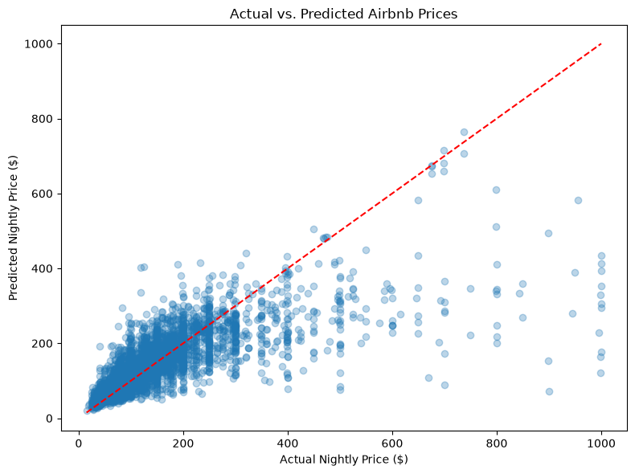
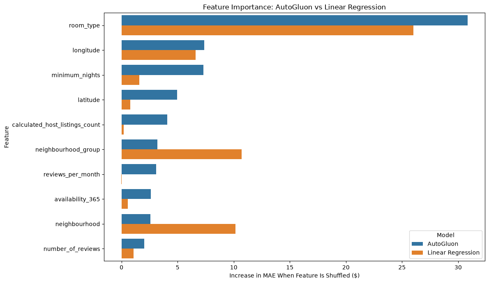
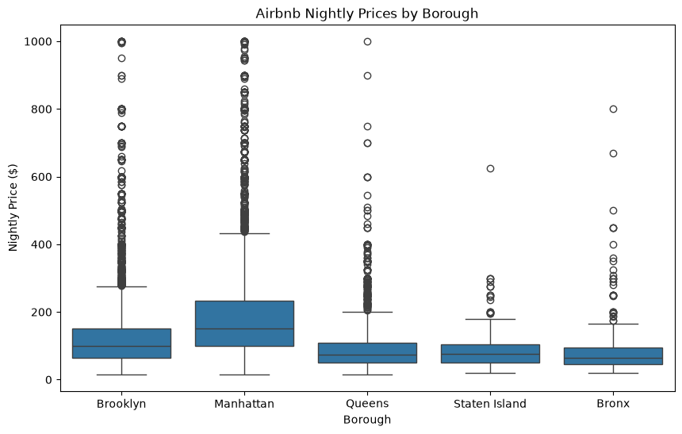
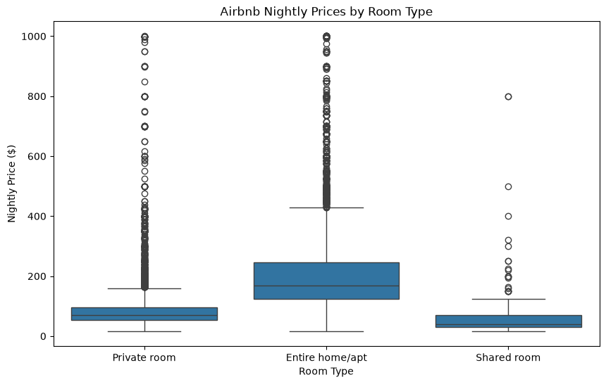
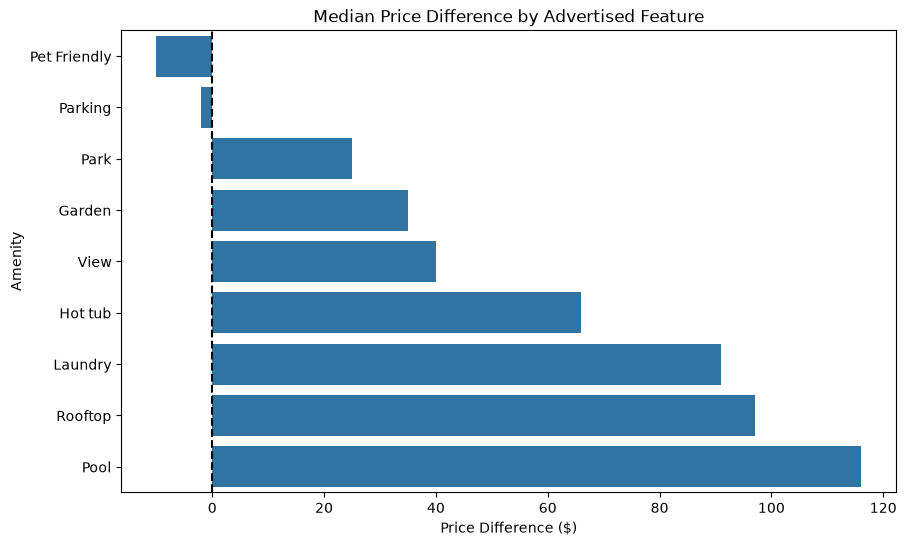

# NYC Airbnb Price Prediction Using AutoGluon

## Project Overview

This project uses machine learning to predict nightly Airbnb prices in New York City using the 2019 NYC Airbnb dataset. I trained AutoGluon regression models and compared their performance with a traditional Linear Regression baseline.

I also examined which features were most useful for predicting prices, how prices varied by borough and room type, and whether amenities advertised in listing names were associated with higher nightly rates.

## Model Performance

| Model | MAE | RMSE | R² |
|---|---:|---:|---:|
| AutoGluon (with listing names) | **$42.70** | **$84.29** | **0.55** |
| AutoGluon (controlled comparison) | $46.28 | $89.43 | 0.49 |
| Linear Regression | $57.60 | $99.74 | 0.36 |

Using the same input features, AutoGluon reduced mean absolute error (MAE) by approximately **19.7%** compared with Linear Regression. Including listing names reduced AutoGluon's MAE by a further 7.7%.

## Dataset and Preprocessing

**Source:** [New York City Airbnb Open Data — Kaggle](https://www.kaggle.com/datasets/dgomonov/new-york-city-airbnb-open-data)

| Dataset | Number of Listings |
|---|---:|
| Original dataset | 48,895 |
| After preprocessing | 19,630 |
| Training set | 15,704 |
| Testing set | 3,926 |

The dataset includes property location, room type, nightly price, minimum stay requirements, reviews, availability, and listing names.

Preprocessing steps:

- Filled missing listing names with `No Name`.
- Removed identifier columns, host names, and last review dates.
- Removed listings with missing reviews-per-month values.
- Retained listings priced between $15 and $1,000 per night with at least 52 days of annual availability.
- Split the data into 80% training and 20% testing sets using a random seed of 42.
- Scaled numerical features using MinMaxScaler, fitted on the training data, and used one-hot encoding for categorical features in Linear Regression.

## Methodology

AutoGluon was used to train multiple regression algorithms, including gradient-boosted trees, Random Forest, Extra Trees, and neural networks. The models were combined into weighted ensembles.

To separate the effect of additional listing information from the modeling approach, I evaluated three configurations:

1. **Original AutoGluon:** Used the prepared features, including listing names.
2. **Controlled AutoGluon:** Excluded listing names to match the input features available to Linear Regression.
3. **Linear Regression:** Served as the traditional regression baseline.

All three configurations were evaluated on the same held-out test observations using MAE, RMSE, and R².

### Performance by Room Type

| Room Type | Test Listings | Average Nightly Price | MAE | R² |
|---|---:|---:|---:|---:|
| Entire home/apartment | 1,948 | $206.45 | $61.87 | 0.40 |
| Private room | 1,878 | $86.52 | $24.12 | 0.42 |
| Shared room | 100 | $53.96 | $18.04 | 0.25 |

The original AutoGluon ensemble produced the largest absolute errors for entire homes and apartments. Shared rooms had the largest MAE relative to their average price, despite having the lowest absolute MAE.

## Feature Importance

Permutation feature importance was used to measure the increase in prediction error when individual features were shuffled.

Room type was the most important feature for both models. Location was also influential, while numerical features such as minimum nights contributed more strongly to AutoGluon's predictions. Listing names provided useful predictive information in the original AutoGluon model.

## Exploratory Data Analysis

### Pricing by Borough

Manhattan had the highest average nightly price at approximately $192, followed by Brooklyn at $126. The difference between mean and median prices was particularly noticeable in Manhattan, suggesting that expensive listings pulled the average upward.

### Pricing by Room Type

Entire homes and apartments generally had higher nightly prices than private and shared rooms. The price distributions help explain why room type was such an important feature in both models.

### Advertised Amenities

Since the dataset does not include a dedicated amenities column, I used keyword matching on listing names to identify advertised property features and compare median prices between listings with and without each keyword.

| Advertised Feature | Matching Listings | Median Price Difference |
|---|---:|---:|
| Pool | 37 | +$116 |
| Rooftop | 149 | +$97 |
| Laundry | 131 | +$91 |
| Hot tub | 13 | +$66 |
| View | 57 | +$40 |
| Garden | 518 | +$35 |
| Park | 1,160 | +$25 |
| Parking | 116 | -$2 |
| Pet friendly | 5 | -$10 |

Listings mentioning pools, rooftops, and laundry facilities were associated with higher median nightly prices. However, some categories had very small sample sizes, and these differences may also reflect property type, location, and other characteristics. The keywords do not establish that the amenities are present or cause higher prices.

Additional visualizations are available in the [figures folder](figures/).

## Technologies Used

- Python, Pandas, NumPy
- AutoGluon, scikit-learn
- Matplotlib, Seaborn
- Jupyter Notebook, VS Code, Conda

## Running the Project

1. Clone the repository and open its root directory.
2. Create and activate the included Conda environment:

   `conda env create -f environment.yml`

   `conda activate airbnb-prediction`

   Alternatively, install the dependencies with `python -m pip install -r requirements.txt` in a compatible Python environment (the Conda configuration specifies Python 3.11).
3. Ensure `AB_NYC_2019.csv` is available in `data/`. The dataset can be downloaded from the Kaggle link above.
4. Open [code.ipynb](code.ipynb) in Jupyter Notebook or VS Code and run the cells in order.

AutoGluon saves trained models locally in `AutogluonModels/`. Training may be computationally intensive, and results may vary with software versions and training randomness. The results reported here are from the original saved experiment.

## Limitations

- The dataset is from 2019 and may not reflect current rental market conditions.
- Preprocessing excluded approximately 60% of the original listings, which limits how well the results generalize to all NYC Airbnb listings.
- The dataset lacks verified amenities, property size, and number of bedrooms.
- A random train/test split does not establish how accurately the models predict future prices. Evaluating multiple configurations on the same test set may also lead to optimistic model selection.
- The controlled comparison uses matching input features but different preprocessing and modeling approaches.

## Conclusion

AutoGluon outperformed Linear Regression in predicting nightly Airbnb prices, even when both models used the same input features. The analysis also identified room type and location as important predictors and explored how advertised property features were associated with nightly rates.

Future improvements could include evaluating newer data, incorporating verified property characteristics, and testing model performance on a separate future or independent dataset.